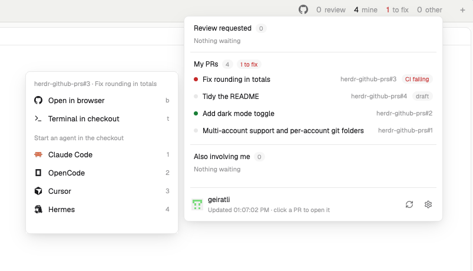

# herdr-github-prs

A [Herdr](https://herdr.dev) **desktop app** mod: a top-bar chip with counts of the GitHub PRs that need your
attention, and a hover card listing them. Click a PR to open it in a browser, a terminal or a coding agent,
in a git worktree made for its branch.



- **Chip:** `review` (asked of you), `mine` (your open PRs), `to fix` (changes requested or CI failing),
  `other` (assigned, mentioned, commented, reviewed), and `to clean` (worktrees of merged or closed PRs).
- **Click menu:** open in browser, a terminal in the checkout, or an agent. If that agent is already running in
  the checkout, Herdr switches to it instead of starting another.
- **Worktrees:** a PR without a local checkout gets one under `~/.herdr/worktrees/<repo>/<branch>` (forks use
  `pr-<n>`) and its own Herdr space. Finished PRs are offered for cleanup.
- **Accounts:** read PRs as any logged-in `gh` account, with per-account git folders and org/repo filters.

## Requirements

- Herdr desktop app (tested with 0.1.14). Needs Herdr's shipped `workspace-chrome` mod (for one icon).
- [`gh`](https://cli.github.com) logged in (2.40+ for the account picker), and `git`.
- macOS is the only platform tested. The helpers are POSIX `sh`; opening a URL uses `open`.

## Install

Short version below; [RECIPE.md](RECIPE.md) has the same steps plus first-run setup.

Tell your agent: *"Read ~/.config/herdr-app/AGENTS.md, then add the mod at https://github.com/geiratli/herdr-github-prs"*,
or by hand:

```sh
git clone https://github.com/geiratli/herdr-github-prs
cp -R herdr-github-prs/mods/github-prs ~/.config/herdr-app/mods/
herdr-app check ~/.config/herdr-app/mods/github-prs
```

Then add a block to a layout in `~/.config/herdr-app/layouts/`:

```json
{ "content": { "mod": "github-prs", "props": { "anchor": "top" } }, "size": { "px": 290 } }
```

Put it in a top row (next to the tabs). `anchor: "top"` makes the card open downward; leave it out for a bottom
status row, where the card opens upward. The chip is about 290 px wide with all five counts.

## Settings (⚙ in the card)

- **GitHub account:** follow gh's active account (default) or pick a login. Nothing is switched globally.
- **Refresh:** 1, 3 (default), 5, 10 or 30 minutes.
- **Filter:** only show, or never show, listed orgs or repos (`acme, acme/widgets`).
- **Git folders:** where your repos live, per account, searched three levels deep. Folders of open spaces are
  always searched too.

## What this mod does

Community mod managers flag mods that run programs, so, plainly:

- It runs `gh`, `git` and `sh` helper scripts (`helpers/`), and `curl` once per login for the avatar.
- Per refresh it makes one GraphQL call to GitHub (four searches) through your own `gh` login, plus
  `gh auth status`, and one `gh pr view` per worktree it created whose PR is no longer listed.
- **Tokens:** the mod never reads, stores, logs or shows a token. With a chosen account, `helpers/gh.sh` puts
  `GH_TOKEN="$(gh auth token --user <login>)"` in the environment of that one `gh` process only. It never runs
  `gh auth switch`.
- **Writes:** git worktrees under `~/.herdr/worktrees`, Herdr spaces and tabs, and avatar images under
  `~/.config/herdr-app/data/github-prs/avatars/`. It force-removes a worktree only when a checkout it started
  seconds earlier fails. Cleanup of finished PRs never uses `--force`.
- **State:** preferences in Herdr shared state: `github-prs.prefs`, `.request`, `.worktrees`, `.active`, `.menu-beat`.
- Herdr does not review mods. Read the code before installing; it is a few hundred lines.

## Known limits

Local machine only (not remote spaces), `.git` scan depth 3, at most 100 PRs per group, macOS first, github.com only.

**Fork PRs are untested.** The code names their local branch `pr-<number>` and checks them out with
`gh pr checkout -b`, but this has never been run against a real fork PR. Reports welcome.

## Development

`lib/*.test.js` are plain assert scripts for the pure code (`model`, `repo`). `herdr-app check mods/github-prs`
validates the mod; edits load live and errors land in `<name>.error`.

## Licence

MIT, see [LICENSE](LICENSE). Icon attributions in [NOTICE.md](NOTICE.md).
